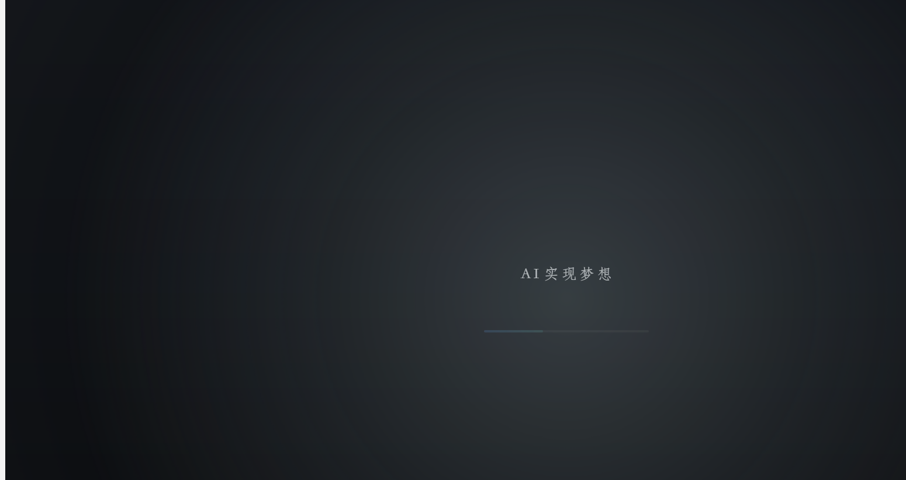
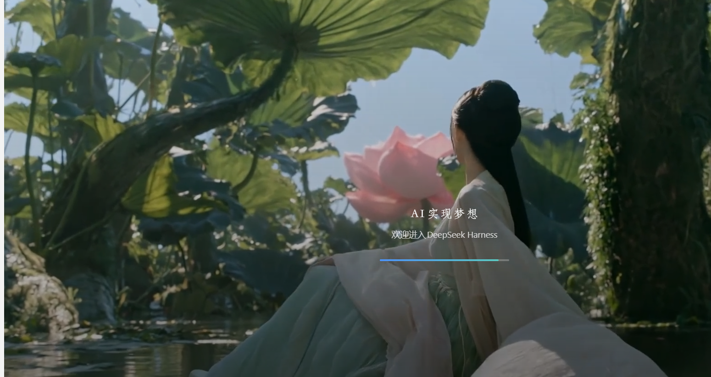
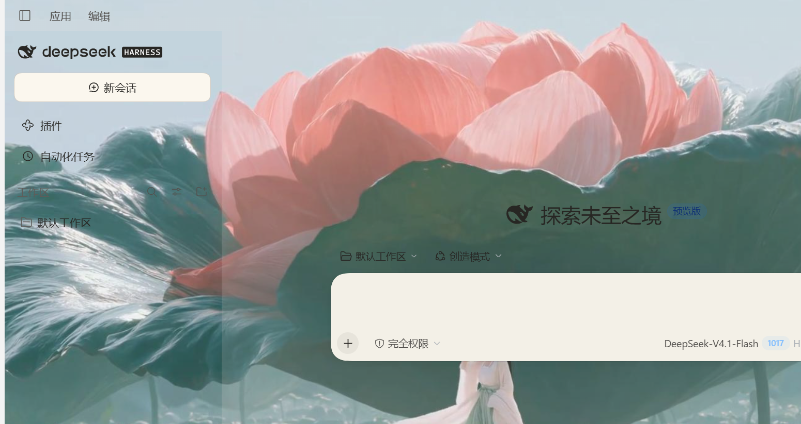

# dsh-boot-anim v2.0

[](https://github.com/deepseek-ai/DeepSeek-Harness)
[](#兼容性)
[](LICENSE)
[](https://github.com/1512750689-collab/DSH-/releases)

**自定义视频/图片开屏 + 第三层冷白数据闪 + 可视化设置面板。**



DSH 启动动画 v2.0：**只播你自己的视频/图片**，叠一层冷白数据闪，然后淡出进入当前皮肤。

> v2.0 已移除最初自带的三套动画（长开场 / 一剑开天门 / DS 方块）。设置面板里不再出现它们的选项；素材加载失败时使用纯色兜底。

## 预览

| 片头轻闪 | 视频 | 进入皮肤 |
| --- | --- | --- |
|  |  |  |

## 安装 / Install

Windows 桌面版：

```sh
dsh plugin --profile desktop add https://github.com/1512750689-collab/DSH-
```

也可以解压后双击 `安装.bat`。安装完**完全退出 DSH** 再重新打开。

- 要求：Windows 10/11、DSH 桌面版、DSH 内核 `>= 0.1.5-rc.1`
- 设置入口：**设置 → 开屏动画**
- 素材放在 `media\`；没有素材时显示纯色兜底，不会黑屏


## v2.0 更新

| 之前 | 现在 |
| --- | --- |
| 内置三套动画（长开场 / 一剑开天门 / DS 方块） | **已移除**，只播你自己的视频/图片 |
| 只有视频层 | 视频层 + **第三层冷白数据闪**（片头轻闪 / 呼吸 / 片尾爆闪 / 光环 / 扫描线） |
| 设置分散 | 新增 **③ 第三层 · 闪烁** 面板，可预览、可从皮肤取色 |
| 开屏结束直接切界面 | 片尾淡出，**保留当前皮肤层** |

## 功能

| 能力 | 说明 |
| --- | --- |
| 自定义素材 | MP4 / WebM / MOV / GIF / PNG / JPG / WebP / AVIF / SVG；HEVC / MKV / AVI 等自动转 H.264 |
| 第三层闪烁 | 冷白核心、光环、水平扫描线、全片呼吸；强度/时长/触发时机可调 |
| 播放控制 | 起点、播多久、循环、素材原声、铺满/模糊/完整显示、裁切焦点 |
| 设置面板 | ① 开屏动画 ② 动画素材 ③ 第三层 · 闪烁 ④ 音乐 ⑤ 落款文字 ⑥ 窗口控件透明 |
| 皮肤衔接 | 读取 `data-dsh-skin` 状态；「从皮肤取色」读取当前皮肤主色；不改皮肤 DOM |
| 起播兜底 | 前 3 秒防误触；JS 硬上限 + CSS 8 秒兜底；素材失败回退纯色，不黑屏 |

## 设置面板

| 分组 | 能改什么 |
| --- | --- |
| ① 开屏动画 | 启用/关闭、兜底时长、可跳过、提示文字 |
| ② 动画素材 | 当前素材、导入、起点/时长、铺满方式、裁切焦点、原声、循环、等素材播完 |
| ③ 第三层 · 闪烁 | 启用、颜色、爆闪强度/时长、触发时机、呼吸光/速度、光环、预览、从皮肤取色 |
| ④ 音乐 | 当前音乐、音量、副歌起点、播放长度 |
| ⑤ 落款文字 | 主标题、副标题、13 种书法字体、字号、颜色 |
| ⑥ 窗口控件透明 | 可选：把右上角按钮区底色改透明，让画面完全铺满 |

## 兼容性

- **Windows 10/11**；DSH 桌面版；DSH 内核 `>= 0.1.5-rc.1`
- 桌面版 profile：`desktop`；网页版需按 `安装说明.txt` 手动挂载
- 插件使用 Windows 注册字体与 PowerShell；`package.json` 已声明 `os: win32`
- 分享包默认不含个人视频；把视频放进 `media\` 即可


## 三层结构

| 层 | 内容 | 负责方 |
| --- | --- | --- |
| 第一层 | 你的开场视频/图片（`media\`） | 本插件 |
| 第二层 | DSH 皮肤/界面（鲸鱼娘等） | 皮肤中心或皮肤插件 |
| 第三层 | 冷白数据闪：片头轻闪 + 全片呼吸 + 片尾爆闪 + 光环 + 扫描线 | 本插件 |

**开屏只覆盖最上层，结束时淡出，不改皮肤层 DOM。**

## 换成你自己的动画 / 音效

```text
%USERPROFILE%\.dsh\plugins\dsh-boot-anim\
  media\        ← 开场视频或图片（mp4 / webm / mov / gif / png / jpg / webp / avif / svg）
  sfx\          ← 开场音效（mp3 / wav / ogg / m4a / aac / flac / opus）
  config.jsonc  ← 时长、文案、闪烁、音量等，注释都写在里面
```

放好文件 → 重启应用即可。

- 素材建议：1920x1080、20MB 以内（每次打开都会读一次）
- 透明桌宠动画（webm）：`"fit"` 改 `contain`（`"veil": "auto"` 已会自动不压暗）
- 目录里多个文件时按文件名排序取第一个

## 三层兜底（不会卡住界面）

1. JS：界面就绪且播满最短时长 → 淡出移除
2. JS 硬上限：最短时长 + 8s
3. CSS：脚本完全没执行也会在最迟 8s 自动淡出

## 关闭 / 卸载

- 临时关：`config.jsonc` 里 `"enabled": false`；或把 profile 的 `package.json` 里 bundles 的 `"dsh-boot-anim"` 删掉
- 卸载：删掉 bundles 里的 `"dsh-boot-anim"` 一行（插件是 link 挂载，删目录也行）

> 注意：用 `dsh plugin` 增删插件时它会重写 bundles 列表，实测可能挤掉 `dsh-pet`，操作后请检查 bundles。

## 实现

宿主插件通过官方注入点 `webserver/index-inject` 写入 `style` / `global` / `html` / `script` 四行，
并通过 `ctx.webServer.register` 提供 `/dsh-boot-anim/asset/media|sfx` 两个本地资源路由（支持 Range）。
`config.jsonc` 由插件自己解析（支持注释与尾随逗号）。不修改 `app.asar`。v2.0 起媒体层与第三层闪烁由 `boot.js` 动态挂载。

## 音效与「副歌截取」

`sfx\` 目录里的文件按文件名排序取第一个（`"sfx": "auto"`），也可以直接写文件名/绝对路径。
支持的格式：`mp3 / wav / ogg / m4a / aac / flac / opus`，以及 `mp4 / mov / m4v / webm`（取音轨，抖音等平台保存的 mp4 可直接用）。

想把某首歌的**副歌**当开场音：

```jsonc
"sfx": "知我.mp3",
"sfxStartMs": 62000,     // 从 1 分 02 秒开始播（毫秒）
"sfxDurationMs": 8000,   // 播 8 秒后淡出；0 = 跟动画一起结束
"sfxFadeOutMs": 1200,    // 淡出时长，避免硬切
"minDurationMs": 8000    // 让开场动画陪着音乐一起变长
```

自带两首本地合成的原创音（无版权，可删）：`00-国风开场.wav`（古琴+鼓+磬+剑鸣，默认）、`开天门.wav`（轰鸣+剑气+光爆）。

自检：按 F12 打开开发者工具，控制台执行 `__dshBootAnim.state()` 可以看到音频时间/音量/是否暂停。
## 可视化设置面板（设置页 → 「开屏动画」）

装好插件后，DSH 的**设置页里会多出一个「开屏动画」分区**，全部用下拉/开关/滑块操作，不用碰配置文件：

| 分组 | 能改什么 |
| --- | --- |
| ① 开屏动画 | 启用/关闭、样式（长开场 / 一剑开天门 / 朴素方块）、时长、可跳过、提示文字 |
| ② 动画素材 | 选 `media\` 里的视频或图片、**从路径导入**（粘贴文件路径即可，微信那种 HEVC 视频会自动用内置 ffmpeg 转成 H.264）、从第几秒开始、播多久、铺满方式、是否用素材原声、循环 |
| ③ 音乐 | 选 `sfx\` 里的音乐、音量、**副歌起点**、播多久 |
| ④ 落款文字 | 主标题、副标题、书法字体（8 种本机字体） |

- **保存** = 写入 `config.jsonc`，重启 DSH 后生效；**保存并立即生效** = 顺手刷新界面（会重新播一次开屏）
- 素材/音乐不用手改路径：面板"从路径导入"会复制进插件目录并出现在下拉里
- 视频是 HEVC（`hvc1`）时 Chromium 放不出来，面板会自动调用 `tools\ffmpeg.exe` 转成 H.264 再入库（40 秒视频约 4 秒转完）

### 关于 HEVC

微信、部分手机导出的 mp4 常是 **HEVC/H.265**：能解析出时长、有声音、但画面是黑的（Chromium 不内置 HEVC 解码）。
插件的导入接口会自动转码；手动放进 `media\` 的 HEVC 文件请在面板里走一次"从路径导入"。
## 导入素材（两步，带反馈）

1. 选类型（视频/图片 或 音乐）→ 点 **「① 选择文件…」** → 弹出系统文件选择框
2. 选中的文件名会出现在「已选文件」那一行 → 点 **「② 确定导入」** 开始上传（按钮变为「导入中…」→「已导入 ✓」，同时显示上传百分比）
3. 导入成功后**自动设为当前素材**，再点「保存并立即生效」即可看到

- 选到 HEVC（微信视频常见）会自动用 `tools\ffmpeg.exe` 转成 H.264 再入库
- 也可以跳过弹窗，直接把完整路径粘进「已选文件」框再点确定导入

## 开屏时长

「时长（秒）」最大 600 秒（10 分钟），进度条会按这个时长走完。想播 3 分钟就填 180。

- 时长 = 开屏至少播多久；有视频素材时，视频播完且超过该时长后才会淡出
- **跳过提示全程闪烁**：只要开着「可跳过」，提示文字会从第 1 秒闪到开屏结束

## 字体颜色

「文字颜色」可选任意色（取色器）+ 6 个预设色块（金/白/朱红/青/紫/蓝），点「默认金」恢复。
## 支持哪些格式

| 类型 | 格式 |
| --- | --- |
| 视频（可直接播） | `.mp4` `.m4v` `.mov`（H.264 / AV1 / VP9）、`.webm`、`.ogv` |
| 视频（导入时自动转码成 H.264 mp4） | `.mkv` `.avi` `.wmv` `.flv` `.mpg` `.mpeg` `.ts` `.m2ts` `.3gp`，以及 HEVC/H.265 的 mp4/mov |
| 图片 | `.png` `.jpg` `.jpeg` `.webp` `.avif` `.gif` `.apng` `.svg` |
| 音乐 | `.mp3` `.wav` `.ogg` `.m4a` `.aac` `.flac` `.opus`，以及带音轨的 `.mp4` `.mov` `.webm` |

判断依据是**视频流编码**而不是扩展名：H.264 / AV1 / VP9 能直接被 Chromium 播放，其它（HEVC、MPEG-4、VC-1…）一律走内置 ffmpeg 转码。

## 素材找不到时会怎样

1. **配置里写的文件不存在** → 不用它，也不"偷偷播目录里其它文件"，直接**回退纯色兜底**；设置页面板会显示红色警告
2. **页面播放时素材加载失败**（文件中途被删 / 编码不支持 / 8 秒还没出画面）→ 页面上**自动切回纯色兜底**，不会卡在黑屏
3. 配置里的素材留空或写 `"auto"` → 用 `media\` 目录里排序第一个文件；目录为空 → 纯色兜底

> 配置改动**不需要重启应用**：点「保存并立即生效」（或手动刷新界面）即可，宿主会在每次渲染界面时重新解析素材与配置。

## 卸载

面板右下角「**卸载插件**」→ 再点一次「确认卸载？」→ 从 `$DSH_HOME/profiles/desktop/package.json` 里移除 `dsh-boot-anim`（bundles 与 dependencies 两处）。
实测不会影响 `dsh-pet`、皮肤中心等其它插件的挂载。重启 DeepSeek Harness 后彻底不加载，开屏动画恢复官方原样。
插件目录 `$DSH_HOME/plugins/dsh-boot-anim` 可手动删除（约 80MB，其中 ffmpeg 占 61MB）。
## 画面铺满方式（三种）

| 模式 | 效果 | 代价 |
| --- | --- | --- |
| **铺满裁切** `cover` | 填满窗口、无黑边，沉浸感和整体性最强，能完全掩盖加载过程 | 宽高比不匹配时**边缘画面被裁掉**（竖屏视频放横屏窗口尤其明显） |
| **模糊填充** `blur` | 画面完整显示、**不裁任何内容**，两侧用同一画面的模糊放大版填满，同样没有黑边 | 两侧是虚化效果（不是原始像素） |
| **完整显示** `contain` | 画面 100% 完整、不变形 | 留下黑边（沉浸感弱） |

> 竖屏视频（微信视频多半是 9:16）放进横屏窗口，推荐 **模糊填充**：人物和场景全在，视觉上也没有黑边。

**裁切焦点**（仅「铺满裁切」时有效）：`居中` / `偏上`（保住头部、标题）/ `偏下`（保住下半身、字幕）——决定裁切时保留画面哪一段。
## 第三层 · 闪烁

默认设计：**冷白数据闪**，和鲸鱼娘的冷蓝全息 UI 对齐。

| 时间 | 画面 |
| --- | --- |
| 片头 0.2s | 冷白轻闪，像屏幕通电 |
| 全片 | 边缘呼吸光（默认 16%，4.5s 一次） |
| 片尾前 1s | 冷白爆闪（默认 900ms，强度 78%） |
| 爆闪同时 | 一圈冷色光环扩散 + 一条水平扫描线从上到下扫过 |

面板「③ 第三层 · 闪烁」可调：启用、颜色、强度、时长、触发时机（片头/片尾/两者/不爆闪）、呼吸强度、呼吸速度、光环开关，以及「预览闪烁」。

「从皮肤取色」会尝试读取当前皮肤的 `--dsw-alias-brand-primary` 等主色 token；读不到时手动选色。

## 关于窗口右上角（重要）

DSH 桌面版主窗口用的是 **Windows 原生标题栏覆盖层**：

```js
titleBarOverlay: { height: 40, color: chromeFallbackFill() /* 深色 #1b1b1c / 浅色 #f9fafb */ }
```

- 这块 **40px 高的条带**（含最小化/最大化/关闭按钮）由 **Electron 主进程直接绘制在网页之上**，不属于网页内容
- 插件是网页层的，**无法覆盖或改变它**；主进程改它颜色的 IPC 也限定了只接受 `dsh-app://app/` 来源，主窗口（`http://127.0.0.1:*`）调不到
- 所以"右上角没铺满"在这套窗口结构下是无解的 —— 任何全屏画面都会在它下面

缓解办法：面板「**顶部与标题栏同色**」（`topBarBlend`）——在开屏顶部 40px 画一条与系统标题栏完全相同的颜色，让画面与标题栏**接成一条**，看起来像影院黑边而不是"画面被切掉"。
## 窗口控件透明（进阶 · 可选）

**问题**：DSH 主窗口右上角的窗口按钮区（最小化 / 最大化 / 关闭 + 底色）由 Electron **主进程**绘制在网页之上，
插件是网页层的，物理上盖不住它（混合模式也不行 —— 混合需要两层像素同时存在，那里网页像素被不透明装饰层完全遮住）。

**办法**：把主进程里那一行底色改成透明：

```js
// resources\app.asar → lib\main.js
nativeTheme.shouldUseDarkColors ? "#1b1b1c" : "#f9fafb"          // 原（55 字符）
nativeTheme.shouldUseDarkColors?"#00000000":"#00000000"          // 补丁（55 字符，等长）
```

### 用法

面板 **「⑤ 窗口控件透明（进阶）」** → **应用并重启** → 再点一次确认 → **完全退出 DeepSeek Harness**（托盘图标右键退出）
→ 脚本自动：等退出 → 备份 → 等长替换 → 校验 → **重新启动 DSH**（约 10 秒）。

### 为什么安全

| 措施 | 说明 |
| --- | --- |
| 等长替换 | 55 → 55 字符，**文件大小与 asar 内所有 offset 完全不变**（实测 115.73 MB → 115.73 MB），不需要重打包 |
| 结构校验 | 替换后重新解析 asar header 并比对文件大小，通过才收工 |
| 自动备份 | `app.asar.bak`（首次应用时创建，之后不覆盖，保留最初那份） |
| 失败自动还原 | 写入前/后校验失败、大小变化、结构异常 → 立即从备份还原 |
| 锚点缺失即跳过 | DSH 大改版导致找不到目标代码时，**不做任何修改**并报告 |
| 幂等 | 已打过补丁再点一次会识别出来，不会重复改 |
| 一键还原 | `tools\还原开屏补丁.bat`（双击，先退出 DSH） |
| 日志 | `tools\patch.log` |

### 已知限制

1. **只改底色，三个按钮图标保留**（刻意如此，否则关窗口都找不到按钮）
2. **DSH 每次自动更新会覆盖补丁**（更新 = 替换 app.asar）→ 回面板看状态（会显示"未应用"），再点一次「应用并重启」即可
3. 关于 asar 完整性校验：本机 exe 的 `EnableEmbeddedAsarIntegrityValidation` fuse 虽是开启状态，
   但 exe 里**没有嵌入完整性数据**（无 `ELECTRONASAR` 资源 / `asarIntegrity` 字样），所以实际不会校验 —— 已实测
## 素材时长与"完整播放"

- **「等素材播完再进入」（默认开）**：素材模式下会**自动读取视频时长**（例如 40.82 秒），视频**完整播完**才淡出进入界面；进度条也按视频时长走完。此时"循环播放"被忽略（只播一遍）。
- **「时长（秒）」**：在没有素材、或关掉上面这个开关时，它是最短展示时长（默认 15 秒）。开了"等素材播完"时以素材为准。
- **「播多久（秒）」**：填了数字就按这个长度截断（例如填 8 = 只播前 8 秒）；填 0 = 播完为止。
- 不想等那么久：播放中**按任意键 / 点击**即可立即进入（「可跳过」开启时）。
## 字体与字号

面板「⑤ 落款文字与字体」里：

| 项 | 说明 |
| --- | --- |
| 书法字体 | 13 种，全部用 **Windows 注册名（中文）**：华文新魏 / 华文行楷 / 华文隶书 / 隶书 / 方正舒体 / 华文楷体 / 楷体 / 华文中宋 / 华文仿宋 / 华文琥珀 / 华文彩云 / 微软雅黑 / 宋体 |
| 主标题字号 | px，**0 = 自动**（素材模式 26–40px） |
| 副标题字号 | px，**0 = 自动** |
| 文字颜色 | 取色器 + 6 个预设色块 + 默认金（已有） |

字体与字号在自定义素材模式下生效；`titleColor` 会直接作用在标题上。

> **改完要「保存并立即生效」或重启 DSH** —— 开屏动画只在页面加载的那一刻读取配置。

**排错**：如果某个字体选了看起来"没变化"，说明该字体名不是系统注册名。可以在注册表查看可用名：
`HKLM\SOFTWARE\Microsoft\Windows NT\CurrentVersion\Fonts`。插件的回退链只退到「微软雅黑 → 系统衬线」，
**不会**再退回另一种书法字体（早期版本因为退回华文新魏，导致"选了没反应"的错觉）。


## 常见问题

**装完没有动画？**  
`media\` 里没有视频/图片时，插件会显示纯色兜底 + 标题/进度条。把 MP4 放进 `media\`，或在设置里导入素材。

**片尾爆闪看不到？**  
默认触发是「片头 + 片尾」。47 秒的视频，片尾爆闪在约 46 秒；想立刻看效果，打开 **设置 → 开屏动画 → ③ 第三层 · 闪烁 → 预览闪烁**。

**设置里没有「③ 第三层 · 闪烁」？**  
按一次 **Ctrl+Shift+R** 硬刷新，清掉旧的客户端 bundle；宿主侧已经是 v2.0。

**会不会改我的皮肤？**  
不会。开屏只覆盖最上层，结束时淡出；皮肤层仍由皮肤中心/皮肤插件管理。


## English

DSH Boot Animation v2.0 is a Windows desktop plugin for DeepSeek Harness. It plays a custom video or image splash, then adds a configurable cold-white flash (soft start, breathing edge, end burst, ring, scanline) before fading into the active DSH skin. The legacy built-in animations were removed in v2.0. A visual settings panel exposes flash color, intensity, duration, trigger, pulse, ring, and preview; a "pick from skin" button reads the active skin accent.

Install with `dsh plugin --profile desktop add https://github.com/1512750689-collab/DSH-` or the included `安装.bat`. Requires Windows 10/11 and DSH `>= 0.1.5-rc.1`. GPL-3.0.

## License

GPL-3.0 — see [LICENSE](LICENSE).

